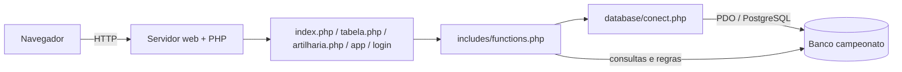
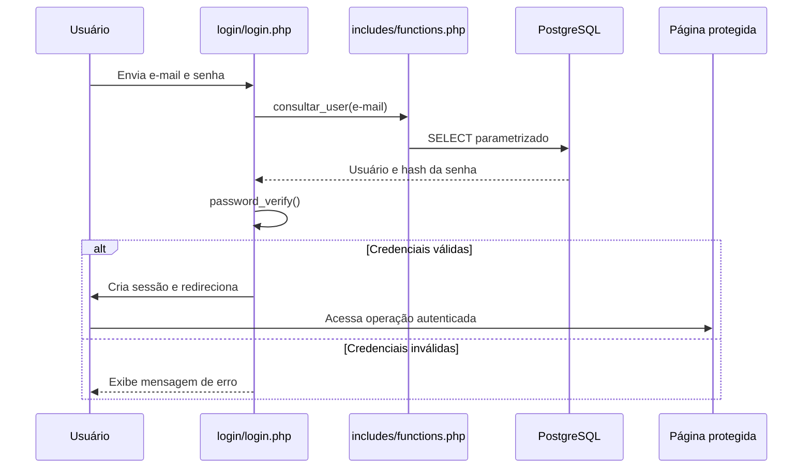
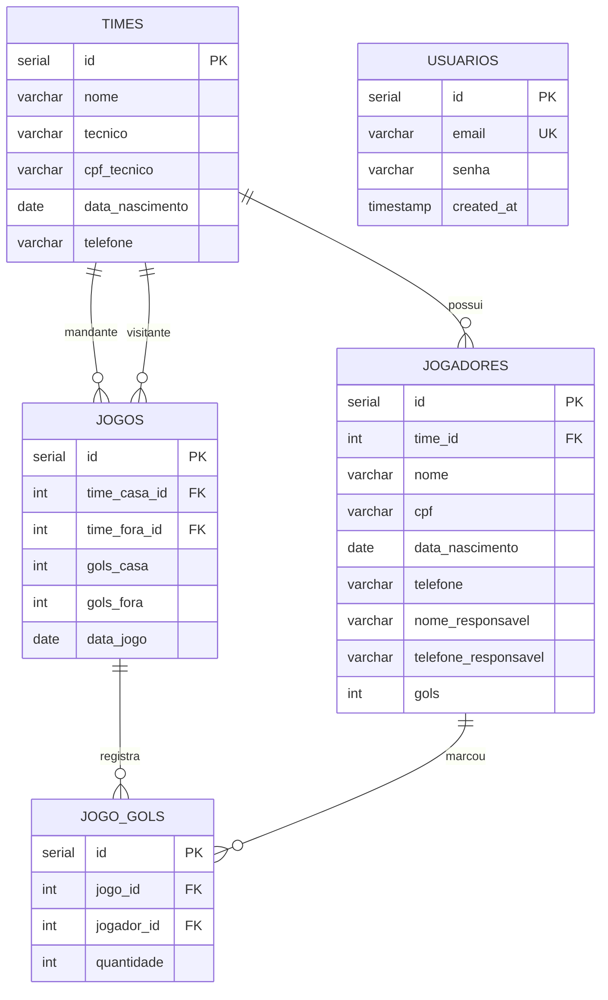
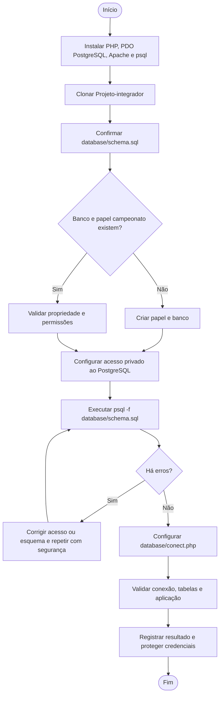

# Copa Bololô — documentação técnica e restauração do banco

Aplicação web em PHP para organizar um campeonato de futebol amador: cadastro de times e jogadores, registro de partidas, classificação e artilharia.


## Sumário

1. [Visão geral](#1-visão-geral)
2. [Requisitos e funcionalidades](#2-requisitos-e-funcionalidades)
3. [Arquitetura e fluxo](#3-arquitetura-e-fluxo)
4. [Modelo de dados](#4-modelo-de-dados)
5. [Restauração do banco](#5-restauração-do-banco)
6. [Fluxograma da restauração](#6-fluxograma-da-restauração)
7. [Dependências e pré-requisitos](#7-dependências-e-pré-requisitos)
8. [Configuração](#8-configuração)
9. [Validação pós-restauração](#9-validação-pós-restauração)
10. [Arquivos relacionados](#10-arquivos-relacionados)
11. [Segurança e operação](#11-segurança-e-operação)
12. [Rastreabilidade e informações pendentes](#12-rastreabilidade-e-informações-pendentes)

## 1. Visão geral

### 1.1 Objetivo

O **Copa Bololô** centraliza informações de um campeonato amador. Visitantes podem consultar a classificação, o histórico de partidas e a artilharia. Usuários cadastrados e autenticados acessam as operações de cadastro e manutenção disponíveis na aplicação.

### 1.2 Tecnologias identificadas

| Camada | Tecnologia |
|---|---|
| Back-end | PHP |
| Acesso a dados | PDO |
| Banco de dados | PostgreSQL |
| Interface | HTML, CSS e JavaScript |
| Servidor de desenvolvimento | Servidor embutido do PHP |
| Controle de versão | Git / GitHub |

O projeto usa `PDO_PGSQL` para conectar ao PostgreSQL. O esquema fornecido está escrito em SQL para PostgreSQL; MySQL não é um banco compatível com esse script sem adaptação.

### 1.3 Estrutura do projeto

```text
Projeto-integrador/
├── README.md
├── index.php                    # Página inicial
├── tabela.php                   # Classificação e histórico de partidas
├── artilharia.php               # Ranking de artilheiros
├── app/                         # CRUD de times/jogadores e registro de partidas
├── login/                       # Cadastro, login, logout e verificação de sessão
├── includes/
│   ├── functions.php            # Consultas e regras da aplicação
│   ├── header.php
│   └── footer.php
├── database/
│   ├── conect.php               # Conexão PDO com o PostgreSQL
│   └── schema.sql               # Criação das tabelas
└── style/
    └── style.css
```

### 1.4 Componentes

- As páginas carregam `includes/functions.php`, que inicia a sessão, configura a URL base e carrega `database/conect.php`.
- `database/conect.php` cria a conexão PDO usada pelas consultas.
- `includes/functions.php` reúne as operações de times, jogadores, usuários, partidas, classificação e artilharia.
- O banco guarda as informações do campeonato. O projeto não contém um dump de dados: `database/schema.sql` cria a estrutura, mas não popula registros de exemplo.

## 2. Requisitos e funcionalidades

### 2.1 Requisitos funcionais observados

| ID | Requisito | Módulo / evidência |
|---|---|---|
| RF01 | Criar conta com e-mail e senha | `login/cadastrar.php`, `cadastrar_user()` |
| RF02 | Autenticar e encerrar sessão | `login/login.php`, `login/logout.php` |
| RF03 | Cadastrar, consultar, listar, atualizar e excluir times | `app/*time*.php`, funções de time |
| RF04 | Cadastrar, consultar, listar, atualizar e excluir jogadores | `app/*jogador*.php`, funções de jogador |
| RF05 | Registrar partidas com times, placar, data e autores dos gols | `app/partidas.php`, `registrar_partida()` |
| RF06 | Consultar tabela de classificação | `tabela.php`, `obter_tabela_classificacao()` |
| RF07 | Consultar partidas e autores dos gols | `tabela.php`, `listar_historico_jogos()` |
| RF08 | Consultar artilheiros | `artilharia.php`, `listar_artilheiros()` |
| RF09 | Calcular pontos, vitórias, empates, derrotas, gols pró/contra e saldo | `obter_tabela_classificacao()` |
| RF10 | Exibir página institucional e regras da competição | `index.php` |

A classificação atribui 3 pontos por vitória e 1 por empate. O desempate implementado considera, nesta ordem, pontos, vitórias, saldo de gols, gols pró e nome do time.

O esquema não possui coluna de perfil ou papel de usuário. Portanto, a documentação não considera a existência de perfis distintos de administrador e cliente: o controle disponível é a exigência de sessão nas páginas protegidas.

### 2.2 Requisitos não funcionais e limites observados

| Categoria | Situação observada |
|---|---|
| Banco | PostgreSQL; conexão via PDO e extensão `pdo_pgsql` |
| Senhas de usuários | Cadastro com `password_hash()` e validação com `password_verify()` |
| Sessão | Sessão PHP; o identificador é renovado após login |
| Consultas | Consultas com parâmetros usam prepared statements; também há consultas fixas sem parâmetros |
| Saída HTML | A função `h()` usa `htmlspecialchars()` para escapar valores exibidos |
| Integridade | Chaves estrangeiras definidas no esquema; exclusões em cascata somente onde especificado |
| Responsividade | Estilos centralizados em `style/style.css`; validar em dispositivos/navegadores do ambiente de destino |
| Dados pessoais | O esquema armazena CPF, telefone e data de nascimento de técnicos e jogadores; restringir acesso e proteger backups |

## 3. Arquitetura e fluxo

### 3.1 Acesso ao banco



### 3.2 Login e operações



Ao registrar uma partida, a aplicação valida os times e o placar, grava o jogo e seus gols em uma transação e atualiza o total de gols dos jogadores. A classificação é calculada a partir dos jogos cadastrados.

## 4. Modelo de dados

As cinco tabelas abaixo constam em `database/schema.sql`.



### 4.1 Relacionamentos e integridade

- `usuarios.email` é único e obrigatório.
- Cada jogador pertence a um time. A exclusão do time apaga seus jogadores (`ON DELETE CASCADE`).
- Cada partida referencia um time da casa e um time visitante. O esquema não define exclusão em cascata para essas referências.
- `jogo_gols` associa jogadores a partidas. Ao excluir uma partida, seus registros em `jogo_gols` são apagados em cascata; a referência ao jogador não tem cascata.
- O campo `jogadores.gols` armazena um total agregado usado pela artilharia. `jogo_gols` guarda os gols registrados em cada partida.
- O esquema não define restrições `CHECK` para placares/quantidades, nem unicidade para CPF ou para o par partida/jogador.

## 5. Restauração do banco

### 5.1 O que será restaurado

O repositório fornece **um script de criação de esquema**, não um backup completo. A execução de `database/schema.sql` cria as tabelas `usuarios`, `times`, `jogadores`, `jogos` e `jogo_gols`; não restaura contas, times, jogadores ou partidas previamente cadastrados.

Os passos abaixo pressupõem Linux com `apt`, acesso `sudo` e que o PostgreSQL esteja no endereço privado `192.168.10.18`. O nome do banco e do usuário informado para a aplicação é `campeonato`. A senha é configurada somente no ambiente, nunca neste documento.

### 5.2 Instalar dependências no servidor da aplicação

```bash
sudo apt update
sudo apt install git apache2 php libapache2-mod-php php-cli php-pgsql postgresql-client -y
sudo systemctl enable --now apache2
```

`postgresql-client` fornece `psql`. Instale o pacote `postgresql` também **na máquina que hospedará o servidor do banco**, caso ele ainda não esteja instalado. Se aplicação e banco estiverem na mesma máquina, instale os dois conjuntos de pacotes nela.

Confira:

```bash
php -v
php -m | grep -i pgsql
psql --version
sudo systemctl status apache2
```

O módulo `pdo_pgsql` deve estar habilitado no PHP usado pelo Apache. Em instalações Linux, o PHP do terminal e o PHP do Apache podem carregar configurações diferentes.

### 5.3 Baixar o projeto

Exemplo de diretório de implantação:

```bash
sudo mkdir -p /var/www/html
sudo git clone https://github.com/filipelucioo/Projeto-integrador.git /var/www/html/Projeto-integrador
cd /var/www/html/Projeto-integrador
```

Confirme a presença do esquema:

```bash
test -s database/schema.sql && echo "schema.sql encontrado"
grep -n "CREATE TABLE" database/schema.sql
```

### 5.4 Criar banco e usuário

Execute estes comandos na máquina do PostgreSQL. Se o banco ou o usuário já existirem, não os recrie: confirme que pertencem ao usuário correto e que este tem permissões suficientes.

```bash
sudo -u postgres psql
```

No prompt `postgres=#`, crie o papel e o banco. Substitua o placeholder por uma senha forte, que não seja compartilhada nem registrada no Git:

```sql
CREATE ROLE campeonato LOGIN PASSWORD '<defina-uma-senha-forte>';
CREATE DATABASE campeonato OWNER campeonato;
\q
```

Para conectar de outra máquina, configure o PostgreSQL para aceitar conexões da rede privada da aplicação, permita a origem apropriada em `pg_hba.conf` e no firewall e mantenha a porta `5432` inacessível pela internet pública. Não altere `listen_addresses` ou regras de acesso sem limitar as origens autorizadas.

### 5.5 Criar as tabelas

Execute a partir da raiz do projeto. O cliente solicitará a senha do papel `campeonato`:

```bash
psql -h 192.168.10.18 -U campeonato -d campeonato -W -f database/schema.sql
```

O resultado esperado inclui mensagens `CREATE TABLE`, sem `ERROR`. O script usa `CREATE TABLE IF NOT EXISTS`, mas isso não substitui migrações: se as tabelas já existirem com estrutura diferente, a execução não atualiza automaticamente as colunas existentes.

> Não use `pg_restore` para `schema.sql`: ele é SQL simples e deve ser executado com `psql`.

## 6. Fluxograma da restauração



## 7. Dependências e pré-requisitos

| Item | Requisito |
|---|---|
| Sistema operacional | Linux com `apt` para os comandos deste guia |
| PHP | PHP CLI e módulo PHP para PostgreSQL; a versão mínima ainda precisa ser confirmada |
| Extensão PHP | `pdo_pgsql` |
| Servidor web | Apache2 nos exemplos; outra configuração exige ajustar a implantação |
| Banco de dados | PostgreSQL |
| Cliente do banco | `psql` |
| Git | Para clonar o repositório |
| Host do banco informado | `192.168.10.18` (endereço de rede privada) |
| Banco e papel informados | `campeonato` |
| Porta | `5432` por padrão; confirmar se o ambiente usa outra |
| Arquivo de estrutura | `database/schema.sql` |

## 8. Configuração

### 8.1 Conexão da aplicação

A conexão é definida em [`database/conect.php`](database/conect.php). O arquivo atualmente usa os campos host, banco, usuário e senha diretamente no código. Configure-os para o ambiente local/de implantação; mantenha credenciais reais fora do Git.

Exemplo apenas ilustrativo, sem senha real:

```php
<?php
$host = '192.168.10.18';
$dbname = 'campeonato';
$user = 'campeonato';
$pass = '<senha-configurada-localmente>';
```

O projeto ainda não lê credenciais de variáveis de ambiente. Para produção, recomenda-se adaptar a conexão para buscar segredos de configuração não versionada e retornar erros sem expor detalhes internos ao visitante.

### 8.2 Executar localmente para desenvolvimento

Com PHP e a extensão `pdo_pgsql` instalados, na raiz do projeto:

```bash
php -S 127.0.0.1:8000
```

Abra `http://127.0.0.1:8000/`. O servidor embutido do PHP serve para desenvolvimento/testes, não para publicação em produção. O host de banco configurado precisa estar acessível pela máquina em que o PHP está rodando.

### 8.3 Servidor Apache

Se o repositório estiver em `/var/www/html/Projeto-integrador`, o endereço de exemplo será `http://<servidor>/Projeto-integrador/`. O projeto calcula a URL base a partir do caminho do script; a URL definitiva depende do VirtualHost e do diretório escolhidos.

## 9. Validação pós-restauração

### 9.1 Banco

- [ ] O host do banco responde na rede privada.
- [ ] Conexão: `psql -h 192.168.10.18 -U campeonato -d campeonato -W -c "SELECT 1;"`
- [ ] As cinco tabelas aparecem:

  ```bash
  psql -h 192.168.10.18 -U campeonato -d campeonato -W -c "\dt"
  ```

- [ ] Colunas e chaves de cada tabela correspondem a `database/schema.sql`.
- [ ] As tabelas começam vazias após uma criação nova; o script não inclui dados de exemplo.
- [ ] Confira contagens:

  ```sql
  SELECT 'usuarios' AS tabela, count(*) FROM usuarios
  UNION ALL SELECT 'times', count(*) FROM times
  UNION ALL SELECT 'jogadores', count(*) FROM jogadores
  UNION ALL SELECT 'jogos', count(*) FROM jogos
  UNION ALL SELECT 'jogo_gols', count(*) FROM jogo_gols;
  ```

- [ ] Confirme que não existem referências órfãs:

  ```sql
  SELECT j.id FROM jogadores j LEFT JOIN times t ON t.id = j.time_id WHERE t.id IS NULL;
  SELECT g.id FROM jogos g
    LEFT JOIN times c ON c.id = g.time_casa_id
    LEFT JOIN times f ON f.id = g.time_fora_id
    WHERE c.id IS NULL OR f.id IS NULL;
  SELECT gg.id FROM jogo_gols gg
    LEFT JOIN jogos j ON j.id = gg.jogo_id
    LEFT JOIN jogadores p ON p.id = gg.jogador_id
    WHERE j.id IS NULL OR p.id IS NULL;
  ```

### 9.2 Aplicação

- [ ] A página inicial abre sem erro de conexão.
- [ ] É possível cadastrar uma conta e entrar com ela.
- [ ] O cadastro e as operações de times e jogadores funcionam.
- [ ] O registro de partida persiste o placar e os autores dos gols.
- [ ] A tabela de classificação reflete partidas cadastradas.
- [ ] A artilharia exibe os gols contabilizados.
- [ ] O logout encerra a sessão e páginas protegidas voltam a exigir autenticação.
- [ ] Verifique o log de erros do PHP/Apache caso algo falhe (por exemplo, `/var/log/apache2/error.log`).

## 10. Arquivos relacionados

| Arquivo | Função |
|---|---|
| [`database/schema.sql`](database/schema.sql) | DDL das tabelas e relacionamentos |
| [`database/conect.php`](database/conect.php) | Parâmetros e conexão PDO |
| [`includes/functions.php`](includes/functions.php) | Consultas, CRUD, autenticação, partida, classificação e artilharia |
| [`includes/header.php`](includes/header.php) | Navegação compartilhada |
| [`index.php`](index.php) | Página inicial e apresentação da competição |
| [`tabela.php`](tabela.php) | Classificação e histórico |
| [`artilharia.php`](artilharia.php) | Ranking de goleadores |
| [`app/`](app/) | Operações de times, jogadores e partidas |
| [`login/`](login/) | Cadastro, login, logout e verificação de sessão |
| [`style/style.css`](style/style.css) | Estilos da interface |

## 11. Segurança e operação

### 11.1 Proteções existentes

- Senhas de contas da aplicação são armazenadas com `password_hash()` e verificadas com `password_verify()`.
- O login renova o identificador da sessão.
- Consultas com valores recebidos do usuário usam parâmetros PDO em prepared statements.
- A função `h()` escapa valores exibidos em HTML em diversos pontos da aplicação.
- O registro de uma partida usa transação para gravar o resultado e os gols em conjunto.
- As páginas protegidas verificam a existência de sessão.

### 11.2 Recomendações

- **Credenciais do banco:** não as armazene no README nem em commits. Remova credenciais reais do histórico do Git, mova a configuração para um mecanismo não versionado e troque qualquer segredo que já tenha sido publicado.
- **Usuários e permissões:** use papel de banco com privilégios mínimos necessários; limite conexões ao host/sub-rede da aplicação.
- **Rede:** não exponha PostgreSQL diretamente à internet. Restrinja firewall e `pg_hba.conf` a origens autorizadas.
- **Backups:** o `schema.sql` não é backup dos dados. Faça backup periódico, armazene-o fora do diretório público, limite permissões e teste a restauração.
- **Dados pessoais:** CPF, telefones e datas de nascimento exigem acesso restrito, armazenamento protegido e política de retenção adequada.
- **Mensagens de erro:** em produção, não mostre erros detalhados de PDO/SQL ao público; registre-os em log protegido.
- **Autorização:** o esquema não tem perfis; qualquer regra que diferencie administrador e usuário comum ainda precisa ser definida e implementada se for necessária.
- **Integridade de gols:** a aplicação permite que gols atribuídos a jogadores sejam menores que o placar do time; o esquema também não impõe essa consistência.
- **Sessões e formulários:** avalie cookies de sessão seguros/HTTP-only, HTTPS e proteção CSRF nas operações que alteram dados.

### 11.3 Backup e restauração de dados (opcional)

Para salvar os dados existentes em formato customizado do PostgreSQL:

```bash
pg_dump -h 192.168.10.18 -U campeonato -W -d campeonato -F c -f campeonato.backup
```

Restaure esse backup em um banco de destino criado previamente:

```bash
pg_restore -h 192.168.10.18 -U campeonato -W -d campeonato --no-owner campeonato.backup
```

Faça e teste backups em local seguro. Não coloque `campeonato.backup` no repositório: ele pode conter credenciais de usuários e dados pessoais.

## 12. Rastreabilidade e informações pendentes

### 12.1 Evidências no repositório

| Informação | Fonte |
|---|---|
| Tabelas, colunas e FKs | [`database/schema.sql`](database/schema.sql) |
| Conexão PostgreSQL via PDO | [`database/conect.php`](database/conect.php) |
| Operações e cálculos | [`includes/functions.php`](includes/functions.php) |
| Rotas e navegação | [`index.php`](index.php), [`tabela.php`](tabela.php), [`artilharia.php`](artilharia.php), [`includes/header.php`](includes/header.php) |
| Login, cadastro e sessão | [`login/`](login/) e [`includes/functions.php`](includes/functions.php) |
| Regras exibidas da competição | [`index.php`](index.php) |
| Host, banco e usuário informados para configuração | Informações fornecidas pelo responsável pelo projeto; confirmar disponibilidade e acesso no servidor |

### 12.2 Informações que faltam para fechar o procedimento de implantação

O README já foi adaptado com o esquema e as informações disponíveis. Para documentar uma instalação reproduzível no seu servidor, ainda é necessário confirmar:

1. Distribuição e versão do Linux (por exemplo, Ubuntu 24.04).
2. Se `192.168.10.18` é o servidor do PostgreSQL, o servidor web, ou ambos; e se a porta do PostgreSQL é a padrão `5432`.
3. Versão do PostgreSQL e do PHP instaladas.
4. Servidor web escolhido (Apache ou Nginx), domínio/IP público ou URL final e diretório de implantação.
5. Se o papel e o banco `campeonato` já existem e se o PHP consegue conectar ao banco a partir do servidor da aplicação.
6. Se o banco precisa iniciar com times/jogadores/partidas de exemplo ou se deve permanecer vazio após executar o esquema.
7. Se todos os usuários cadastrados terão os mesmos acessos ou se haverá perfis (o esquema atual não define papéis).
8. Se existe um backup de dados a restaurar; atualmente o repositório contém apenas o esquema, não um dump com registros.

