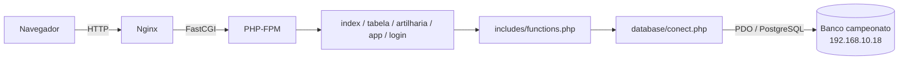
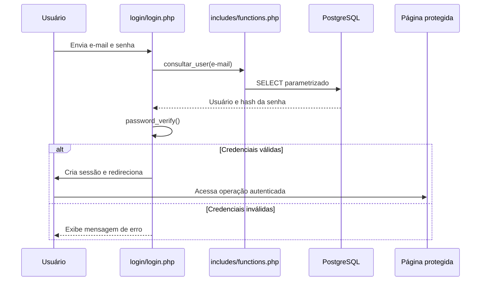
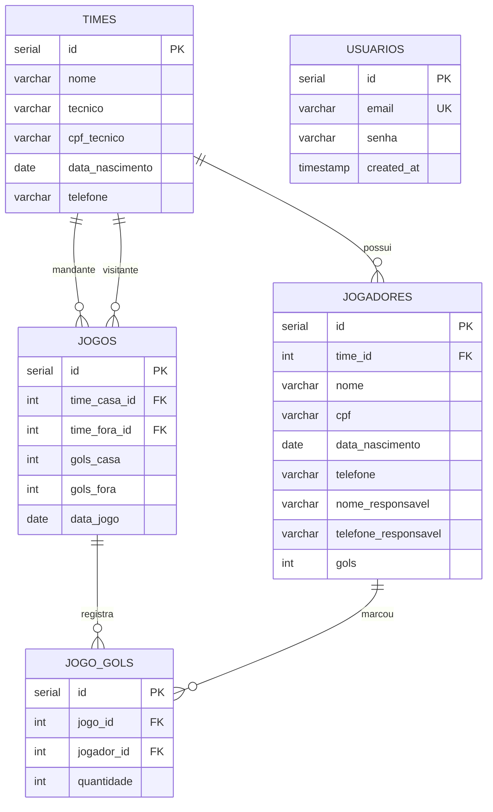
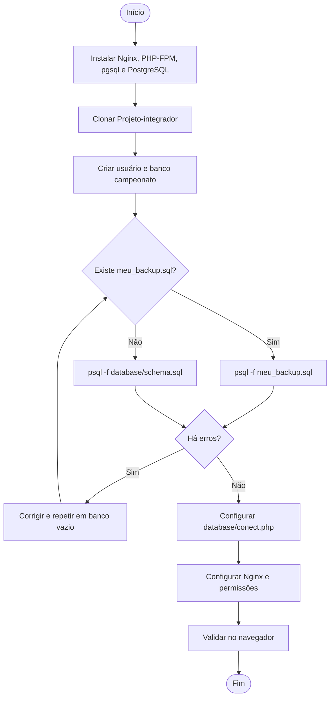

# Copa Bololô — documentação técnica, dump e restauração do banco

Aplicação web em PHP para organizar um campeonato de futebol amador: cadastro de times e jogadores, registro de partidas, classificação e artilharia.

## Sumário

1. [Visão geral](#1-visão-geral)
2. [Requisitos e funcionalidades](#2-requisitos-e-funcionalidades)
3. [Arquitetura e fluxo](#3-arquitetura-e-fluxo)
4. [Modelo de dados](#4-modelo-de-dados)
5. [Ambiente do projeto](#5-ambiente-do-projeto)
6. [Criar as tabelas (banco vazio)](#6-criar-as-tabelas-banco-vazio)
7. [Gerar o dump (backup)](#7-gerar-o-dump-backup)
8. [Restaurar o dump em outra máquina — passo a passo](#8-restaurar-o-dump-em-outra-máquina--passo-a-passo)
9. [Fluxograma da restauração](#9-fluxograma-da-restauração)
10. [Validação](#10-validação)
11. [Arquivos relacionados](#11-arquivos-relacionados)
12. [Proteções existentes](#12-proteções-existentes)

---

## 1. Visão geral

### 1.1 Objetivo

O **Copa Bololô** centraliza as informações de um campeonato amador. Visitantes consultam a classificação, o histórico de partidas e a artilharia. Usuários cadastrados e autenticados acessam as operações de cadastro e manutenção.

### 1.2 Tecnologias

| Camada | Tecnologia |
|---|---|
| Back-end | PHP 8.0 ou superior |
| Acesso a dados | PDO + driver `pgsql` |
| Banco de dados | PostgreSQL |
| Servidor web | Nginx + PHP-FPM |
| Front-end | HTML + CSS |
| Controle de versão | Git / GitHub |

O projeto usa `PDO_PGSQL`. O esquema é escrito em SQL para PostgreSQL; não é compatível com MySQL sem adaptação.

### 1.3 Estrutura do projeto

```text
Projeto-integrador/
├── README.md
├── index.php                    # Página inicial
├── tabela.php                   # Classificação e histórico de partidas
├── artilharia.php               # Ranking de artilheiros
├── app/                         # CRUD de times/jogadores e registro de partidas
├── login/                       # Cadastro, login, logout e verificação de sessão
├── includes/
│   ├── functions.php            # Consultas e regras da aplicação
│   ├── header.php
│   └── footer.php
├── database/
│   ├── conect.php               # Conexão PDO com o PostgreSQL
│   └── schema.sql               # Criação das tabelas
└── style/
    └── style.css
```

### 1.4 Componentes

- As páginas carregam `includes/functions.php`, que inicia a sessão, configura a URL base e carrega `database/conect.php`.
- `database/conect.php` cria a conexão PDO usada pelas consultas.
- `includes/functions.php` reúne as operações de times, jogadores, usuários, partidas, classificação e artilharia.
- O banco guarda as informações do campeonato. `database/schema.sql` cria a estrutura (sem dados). Os dados existentes são levados de uma máquina para outra pelo **dump** (seção 7).

## 2. Requisitos e funcionalidades

### 2.1 Requisitos funcionais

| ID | Requisito | Módulo |
|---|---|---|
| RF01 | Criar conta com e-mail e senha | `login/cadastrar.php`, `cadastrar_user()` |
| RF02 | Autenticar e encerrar sessão | `login/login.php`, `login/logout.php` |
| RF03 | Cadastrar, consultar, listar, atualizar e excluir times | `app/*time*.php` |
| RF04 | Cadastrar, consultar, listar, atualizar e excluir jogadores | `app/*jogador*.php` |
| RF05 | Registrar partidas com times, placar, data e autores dos gols | `app/partidas.php`, `registrar_partida()` |
| RF06 | Consultar tabela de classificação | `tabela.php`, `obter_tabela_classificacao()` |
| RF07 | Consultar partidas e autores dos gols | `tabela.php`, `listar_historico_jogos()` |
| RF08 | Consultar artilheiros | `artilharia.php`, `listar_artilheiros()` |
| RF09 | Calcular pontos, vitórias, empates, derrotas, gols pró/contra e saldo | `obter_tabela_classificacao()` |
| RF10 | Exibir página institucional e regras da competição | `index.php` |

A classificação atribui 3 pontos por vitória e 1 por empate. O desempate considera, nesta ordem: pontos, vitórias, saldo de gols, gols pró e nome do time.

Não há perfis de usuário (administrador/cliente): o controle de acesso é a exigência de sessão nas páginas protegidas.

### 2.2 Requisitos não funcionais

| Categoria | Situação |
|---|---|
| Banco | PostgreSQL via PDO e extensão `pdo_pgsql` |
| Senhas | `password_hash()` no cadastro e `password_verify()` no login |
| Sessão | Sessão PHP; identificador renovado após o login |
| Consultas | Prepared statements nas consultas com parâmetros |
| Saída HTML | Função `h()` (`htmlspecialchars()`) para escapar valores |
| Integridade | Chaves estrangeiras no esquema; cascata somente onde especificado |

## 3. Arquitetura e fluxo

### 3.1 Acesso ao banco



### 3.2 Login e operações



Ao registrar uma partida, a aplicação valida times e placar, grava o jogo e seus gols em uma transação e atualiza o total de gols dos jogadores. A classificação é calculada a partir dos jogos cadastrados.

## 4. Modelo de dados

As cinco tabelas constam em `database/schema.sql`.



### 4.1 Relacionamentos e integridade

- `usuarios.email` é único e obrigatório.
- Cada jogador pertence a um time. Excluir o time apaga seus jogadores (`ON DELETE CASCADE`).
- Cada partida referencia um time da casa e um visitante, sem cascata nessas referências.
- `jogo_gols` associa jogadores a partidas. Excluir uma partida apaga seus registros em `jogo_gols`; a referência ao jogador não tem cascata.
- `jogadores.gols` guarda o total agregado usado pela artilharia; `jogo_gols` guarda os gols de cada partida.
- Não há `CHECK` para placares/quantidades, nem unicidade para CPF ou para o par partida/jogador.

### 4.2 Script de criação (`database/schema.sql`)

```sql
-- Script do Banco de Dados para Copa Bololô (PostgreSQL)

CREATE TABLE IF NOT EXISTS usuarios (
    id SERIAL PRIMARY KEY,
    email VARCHAR(150) UNIQUE NOT NULL,
    senha VARCHAR(255) NOT NULL,
    created_at TIMESTAMP DEFAULT CURRENT_TIMESTAMP
);

CREATE TABLE IF NOT EXISTS times (
    id SERIAL PRIMARY KEY,
    nome VARCHAR(100) NOT NULL,
    tecnico VARCHAR(100) NOT NULL,
    cpf_tecnico VARCHAR(14) NOT NULL,
    data_nascimento DATE NOT NULL,
    telefone VARCHAR(20)
);

CREATE TABLE IF NOT EXISTS jogadores (
    id SERIAL PRIMARY KEY,
    time_id INT NOT NULL,
    nome VARCHAR(100) NOT NULL,
    cpf VARCHAR(14) NOT NULL,
    data_nascimento DATE NOT NULL,
    telefone VARCHAR(20),
    nome_responsavel VARCHAR(100),
    telefone_responsavel VARCHAR(20),
    gols INT DEFAULT 0,
    FOREIGN KEY (time_id) REFERENCES times(id) ON DELETE CASCADE
);

CREATE TABLE IF NOT EXISTS jogos (
    id SERIAL PRIMARY KEY,
    time_casa_id INT NOT NULL,
    time_fora_id INT NOT NULL,
    gols_casa INT DEFAULT 0,
    gols_fora INT DEFAULT 0,
    data_jogo DATE NOT NULL,
    FOREIGN KEY (time_casa_id) REFERENCES times(id),
    FOREIGN KEY (time_fora_id) REFERENCES times(id)
);

-- gols de cada jogador em cada jogo (usada na tabela e no histórico)
CREATE TABLE IF NOT EXISTS jogo_gols (
    id SERIAL PRIMARY KEY,
    jogo_id INT NOT NULL,
    jogador_id INT NOT NULL,
    quantidade INT NOT NULL,
    FOREIGN KEY (jogo_id) REFERENCES jogos(id) ON DELETE CASCADE,
    FOREIGN KEY (jogador_id) REFERENCES jogadores(id)
);
```

## 5. Ambiente do projeto

| Item | Valor |
|---|---|
| Acesso aos servidores | SSH pelo MobaXterm |
| Servidor do PostgreSQL | `192.168.10.18` (rede privada), porta `5432` |
| Banco | `campeonato` |
| Usuário do banco | `campeonato` |
| Servidor web | Nginx + PHP-FPM |
| Diretório de implantação | `/var/www/html/Projeto-integrador` |

O banco e o usuário `campeonato` já existem no servidor `192.168.10.18`, e o servidor da aplicação já consegue conectar a ele. Para uma máquina nova, siga a seção 8.

## 6. Criar as tabelas (banco vazio)

O banco pode começar sem dados. Na raiz do projeto, execute o esquema:

```bash
psql -h 192.168.10.18 -U campeonato -d campeonato -W -f database/schema.sql
```

O `-W` pede a senha do usuário `campeonato`. A saída esperada contém mensagens `CREATE TABLE`, sem `ERROR`. Confirme:

```bash
psql -h 192.168.10.18 -U campeonato -d campeonato -W -c "\dt"
```

Devem aparecer `usuarios`, `times`, `jogadores`, `jogos` e `jogo_gols`.

> `schema.sql` é SQL simples: use `psql`, não `pg_restore`. O script usa `CREATE TABLE IF NOT EXISTS`, que **não** atualiza tabelas já existentes com estrutura diferente.

## 7. Gerar o dump (backup)

Rode no terminal do **servidor do PostgreSQL** (`192.168.10.18`), pois o host é `localhost`:

```bash
pg_dump -U postgres -h localhost -p 5432 -F p -b -v -f meu_backup.sql campeonato
```

| Opção | Significado |
|---|---|
| `-U postgres` | usuário que executa o dump |
| `-h localhost -p 5432` | servidor e porta do PostgreSQL |
| `-F p` | formato **plain** (SQL puro, texto) |
| `-b` | inclui objetos grandes (blobs) |
| `-v` | modo detalhado (mostra o progresso) |
| `-f meu_backup.sql` | arquivo de saída |
| `campeonato` | banco que será exportado |

Confira se o arquivo foi gerado e se tem as tabelas:

```bash
ls -lh meu_backup.sql
grep -n "CREATE TABLE" meu_backup.sql
```

Como o formato é SQL puro, ele é restaurado com `psql -f` (nunca com `pg_restore`).

Para copiar o arquivo para outra máquina, use o painel lateral de arquivos (SFTP) do MobaXterm — arraste `meu_backup.sql` para o computador — ou o comando `scp`:

```bash
scp usuario@192.168.10.18:~/meu_backup.sql .
```

## 8. Restaurar o dump em outra máquina — passo a passo

**Pré-requisitos:** Linux com `apt`, usuário com `sudo` e acesso à internet. Tenha o arquivo `meu_backup.sql` na máquina.

### 8.1 Instalar e iniciar os serviços

```bash
sudo apt update && sudo apt install git nginx php-fpm php-cli php-pgsql postgresql postgresql-contrib -y
PHPV=$(php -r 'echo PHP_MAJOR_VERSION.".".PHP_MINOR_VERSION;')
sudo systemctl enable --now postgresql nginx php${PHPV}-fpm
```

Conferir:

```bash
php -v                                  # precisa ser 8.0 ou superior
php -m | grep -i pgsql                  # deve listar pdo_pgsql e pgsql
sudo systemctl status postgresql        # deve mostrar active
sudo systemctl status nginx
```

O Nginx não executa PHP sozinho: ele repassa os arquivos `.php` ao **PHP-FPM**, por isso o pacote é `php-fpm`. Se o Apache estiver instalado, pare-o para liberar a porta 80:

```bash
sudo systemctl stop apache2
sudo systemctl disable apache2
```

### 8.2 Baixar o projeto

```bash
sudo mkdir -p /var/www/html
sudo git clone https://github.com/filipelucioo/Projeto-integrador.git /var/www/html/Projeto-integrador
cd /var/www/html/Projeto-integrador
```

Conferir: `ls -lh database/schema.sql` deve mostrar o arquivo com tamanho maior que zero.

### 8.3 Criar usuário e banco

Entre no terminal do PostgreSQL:

```bash
sudo -u postgres psql
```

Com o prompt `postgres=#` aberto, execute um comando por vez:

```sql
CREATE USER campeonato WITH PASSWORD 'campeonato';
CREATE DATABASE campeonato OWNER campeonato;
GRANT ALL PRIVILEGES ON DATABASE campeonato TO campeonato;
\q
```

Resultado esperado: `CREATE ROLE`, `CREATE DATABASE` e `GRANT`. O `\q` sai do PostgreSQL. Se aparecer `already exists`, o usuário ou o banco já existe e você pode seguir para o próximo passo.

### 8.4 Restaurar o dump

Vá até a pasta onde está o `meu_backup.sql` e execute:

```bash
psql -U campeonato -h localhost -d campeonato -f meu_backup.sql
```

O `-h localhost` evita o erro de autenticação *peer*. O dump é SQL puro, então use `psql`, não `pg_restore`. A saída deve conter `SET`, `CREATE TABLE`, `COPY` etc., **sem nenhum `ERROR`**.

> Restaure em um banco **vazio**. Se o banco já tiver as tabelas, aparecerão erros `already exists`. Para recomeçar do zero:
> `sudo -u postgres psql -c "DROP DATABASE campeonato;"` e depois `sudo -u postgres psql -c "CREATE DATABASE campeonato OWNER campeonato;"`.

Conferir:

```bash
psql -U campeonato -h localhost -d campeonato -c "\dt"
```

As tabelas `usuarios`, `times`, `jogadores`, `jogos` e `jogo_gols` devem aparecer, já com os dados que estavam no dump. Não é preciso criar nenhuma tabela manualmente.

> **Sem dump?** Para começar com o banco vazio, use `psql -U campeonato -h localhost -d campeonato -f database/schema.sql` no lugar do dump.

### 8.5 Configurar a conexão

```bash
cd /var/www/html/Projeto-integrador
sudo nano database/conect.php
```

Ajuste os campos para a máquina atual (banco local):

```php
$host = 'localhost';
$dbname = 'campeonato';
$user = 'campeonato';
$pass = 'campeonato';
```

Salve no `nano` com `Ctrl+O`, `Enter`, e saia com `Ctrl+X`.

### 8.6 Configurar o Nginx

Crie o arquivo do site:

```bash
sudo nano /etc/nginx/sites-available/campeonato
```

```nginx
server {
    listen 80 default_server;
    server_name _;

    root /var/www/html;
    index index.php index.html;

    location / {
        try_files $uri $uri/ =404;
    }

    location ~ \.php$ {
        include snippets/fastcgi-php.conf;
        fastcgi_pass unix:/run/php/php8.3-fpm.sock;   # ajuste para a sua versão
    }

    location ~ /\.ht {
        deny all;
    }
}
```

Descubra o nome correto do socket do PHP-FPM e ajuste a linha `fastcgi_pass`:

```bash
ls /run/php/
```

Ative o site, valide e recarregue:

```bash
sudo ln -sf /etc/nginx/sites-available/campeonato /etc/nginx/sites-enabled/campeonato
sudo rm -f /etc/nginx/sites-enabled/default
sudo nginx -t
sudo systemctl reload nginx
```

`nginx -t` deve responder `syntax is ok` e `test is successful`.

### 8.7 Permissões

```bash
sudo chown -R www-data:www-data /var/www/html/Projeto-integrador
```

### 8.8 Validar a aplicação

Abra no navegador `http://<servidor>/Projeto-integrador/index.php` (na própria máquina, `http://localhost/Projeto-integrador/index.php`).

1. A página inicial abre sem erro de conexão.
2. Abra a classificação (`tabela.php`) e a artilharia (`artilharia.php`): os dados restaurados devem aparecer.
3. Cadastre uma conta em `login/cadastrar.php` e entre com ela.
4. Confira os dados direto no banco:

```bash
psql -U campeonato -h localhost -d campeonato -c "SELECT id, nome FROM times;"
```

Se algo falhar, consulte os logs:

```bash
sudo tail -n 30 /var/log/nginx/error.log
```

### 8.9 Alternativa rápida para desenvolvimento

Com PHP e `pdo_pgsql` instalados, na raiz do projeto:

```bash
php -S 127.0.0.1:8000
```

Abra `http://127.0.0.1:8000/`. O servidor embutido serve só para desenvolvimento e testes.

## 9. Fluxograma da restauração



## 10. Validação

### 10.1 Banco

- [ ] Conexão: `psql -h localhost -U campeonato -d campeonato -W -c "SELECT 1;"`
- [ ] As cinco tabelas aparecem em `\dt`.
- [ ] Contagens após a restauração:

  ```sql
  SELECT 'usuarios' AS tabela, count(*) FROM usuarios
  UNION ALL SELECT 'times', count(*) FROM times
  UNION ALL SELECT 'jogadores', count(*) FROM jogadores
  UNION ALL SELECT 'jogos', count(*) FROM jogos
  UNION ALL SELECT 'jogo_gols', count(*) FROM jogo_gols;
  ```

  Os números devem ser iguais aos do banco de origem (ou zero, se o banco foi criado só com o esquema).

- [ ] Sem referências órfãs:

  ```sql
  SELECT j.id FROM jogadores j LEFT JOIN times t ON t.id = j.time_id WHERE t.id IS NULL;
  SELECT g.id FROM jogos g
    LEFT JOIN times c ON c.id = g.time_casa_id
    LEFT JOIN times f ON f.id = g.time_fora_id
    WHERE c.id IS NULL OR f.id IS NULL;
  SELECT gg.id FROM jogo_gols gg
    LEFT JOIN jogos j ON j.id = gg.jogo_id
    LEFT JOIN jogadores p ON p.id = gg.jogador_id
    WHERE j.id IS NULL OR p.id IS NULL;
  ```

  As três consultas devem retornar zero linhas.

### 10.2 Aplicação

- [ ] A página inicial abre sem erro de conexão.
- [ ] É possível cadastrar uma conta e entrar.
- [ ] Cadastro e edição de times e jogadores funcionam.
- [ ] O registro de partida grava o placar e os autores dos gols.
- [ ] A classificação reflete as partidas cadastradas.
- [ ] A artilharia exibe os gols contabilizados.
- [ ] O logout encerra a sessão e as páginas protegidas voltam a exigir login.

## 11. Arquivos relacionados

| Arquivo | Função |
|---|---|
| [`database/schema.sql`](database/schema.sql) | DDL das tabelas e relacionamentos |
| [`database/conect.php`](database/conect.php) | Parâmetros e conexão PDO |
| [`includes/functions.php`](includes/functions.php) | Consultas, CRUD, autenticação, partida, classificação e artilharia |
| [`includes/header.php`](includes/header.php) | Navegação compartilhada |
| [`index.php`](index.php) | Página inicial e apresentação da competição |
| [`tabela.php`](tabela.php) | Classificação e histórico |
| [`artilharia.php`](artilharia.php) | Ranking de goleadores |
| [`app/`](app/) | Operações de times, jogadores e partidas |
| [`login/`](login/) | Cadastro, login, logout e verificação de sessão |
| [`style/style.css`](style/style.css) | Estilos da interface |

## 12. Proteções existentes

- Senhas armazenadas com `password_hash()` e verificadas com `password_verify()`.
- Identificador de sessão renovado no login.
- Consultas com valores do usuário usam prepared statements.
- A função `h()` escapa valores exibidos em HTML.
- O registro de partida usa transação para gravar resultado e gols juntos.
- Páginas protegidas verificam a existência de sessão.
